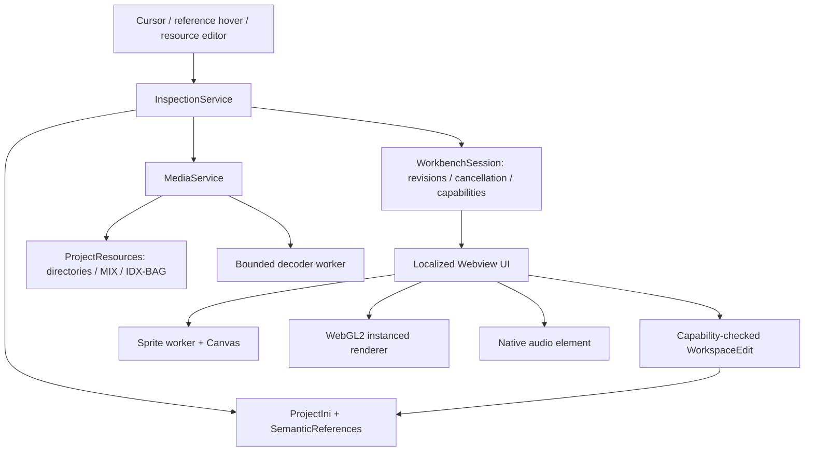

# Asset Workbench

## User workflow

1. Open a mod as a VS Code workspace and configure its dictionary and file categories as usual.
2. Expand **Object Inspector** in the RA2 activity bar. Drag it to the secondary sidebar for a persistent view beside the INI. Cursor movement follows the current section or reference value; **Pin** retains a target while editing elsewhere.
3. Select a particular `AnimList` member or sound event value to inspect that reference. Key documentation remains available on the tag; media hover targets the value.
4. Edit SHP actions, existing FLH points or global voxel lighting and use **Apply to INI**. Edits preserve comments and additional action fields, use the native undo stack and leave saving to the user. An inherited action/point is overridden in its owning section rather than silently changing the parent. Shared sequence edits affect all users displayed by the inspector.
5. Use **Browse assets** for the project library, or open a resource directly in its custom editor. The editor attempts to recover the asset's rules/art owner. **Keep for comparison** retains a media snapshot and synchronizes the view; **Clear comparison** releases it.
6. Use **Check project resources** for an explicit, cancellable audit. It does not run automatically when editing.

## Configuration

```jsonc
{
    "ra2-ini-intellisense.media.enabled": true,
    "ra2-ini-intellisense.media.inlineThumbnails": true,
    "ra2-ini-intellisense.media.hoverEnabled": true,
    "ra2-ini-intellisense.media.resourceRoots": ["D:/Games/RA2"],
    "ra2-ini-intellisense.media.archiveOrder": ["expandmd99.mix", "ra2md.mix"],
    "ra2-ini-intellisense.media.theater": "tem",
    "ra2-ini-intellisense.media.semanticRules": [
        { "owner": "TechnoType", "key": "PreviewArt", "kind": "image", "extension": ".pcx" },
        { "category": "rules", "key": "AlternateExplosion", "kind": "animation" }
    ]
}
```

Custom semantic rules are additive; the first matching custom rule precedes built-ins. They can match `owner` (with type inheritance), file `category`, `key`, and dictionary `valueType`; `kind` selects object, animation, sound, image, palette, sequence, FLH or lighting interpretation. The dictionary still governs completion and validation. Resource roots accept directories, relative paths or supported filesystem URIs.

Lookup uses loose project files first, then configured MIX order, then unlisted archives; additional roots follow the project root. Equal priorities retain every source and produce ambiguity warnings rather than hiding a choice. Known filenames resolve through MIX hashes even when a filename database cannot label the entry. Companion HVA/turret/barrel resources prefer the main asset's directory/archive before general fallback.

INI resolution is project-scoped and includes open, unsaved text. Effective properties merge case-insensitive section IDs, duplicate property definitions and inherited parents with cycle/depth guards. When multiple INIs define the same property, the currently inspected document wins, followed by deterministic URI order. This is editor precedence, not an emulation of every engine/include loading order; use the source links to inspect overrides. Custom rules/art/sound filenames must match the extension's existing category configuration.

## Architecture



- `src/context` owns semantic inspection, source links, hover/decorations, protocol, lifecycle, audits and visual edits. UI messages carry opaque session/capability IDs; the host retains paths, versions and original values.
- `src/resources/project-resources.ts` owns project scope, directory/archive indexing, precedence, range reads, cache invalidation and raw bytes. `ra2mix:` access uses the existing archive manager.
- `src/media` contains independently testable format decoders, transforms and PNG/WAV encoders. A worker thread isolates binary parsing. Decode caches clone results before reuse so HVA attachment and limb composition cannot mutate cached models.
- `webview-ui/workbench` owns controls and drawing. A separate browser worker decodes SHP frames/contact sheets. VXL buffers use WebGL2 instancing; disposal releases workers, animation frames, GL buffers, textures and audio Blob URLs. Hidden views pause playback.
- The resource custom editor keeps existing map previews intact. Earlier SHP/VXL code remains available to legacy call sites; new resource editors use the shared workbench.
- Static browser scripts/styles are bundled locally. CSP disables remote scripts, only the inspector command is trusted in media hovers, and filenames/INI content are rendered as text rather than HTML.

## Formats and boundaries

| Resource | Supported path |
| --- | --- |
| TS/RA2 SHP | Raw and scanline formats 0–3, transparent frames, indexed palettes, house color, sequence directions |
| RA2 VXL/HVA | Span data, normal mode 4, case-insensitive HVA limb matching, body/turret/barrel assembly |
| PAL / VPL | 6-bit or 8-bit palettes, validated VPL tables, project or bundled fallback |
| PCX | Indexed and RGB planes, row padding, raw/RLE encoding |
| WAV | PCM and supported Microsoft/IMA ADPCM decoding to PCM WAV |
| IDX/BAG | Standard GABA v2 catalog, PCM/IMA sample flags, bounded selected-sample reads |
| MIX | Named/hash lookup, nested archives, RSA/Blowfish encrypted header reads; encrypted mutation is rejected |
| MP3/OGG/FLAC | Browser codec dependent; not decoded by the host |

Game view uses authored normals, VPL shading and Phobos light direction/fixed-light controls, but remains a preview approximation. It does not reproduce every game rendering pass, map lighting effect or firing rule. FLH uses an adjustable leptons-to-model-unit scale (default 8); validate placement and final visuals in game. Unsupported VXL normal tables fail explicitly instead of using an incorrect RA2 table. Missing companion files do not prevent viewing the main asset.

Limits are intentional: 4M pixels per decoded image, 500,000 voxels per VXL file, 128 limbs, 4,096 HVA frames/65,536 limb poses, 64 MiB raw/decode caches, 16 queued decoder jobs, 15-second decode timeout, 100,000 catalog entries/16 traversal levels, 2,000 INIs on initial context load, 10,000 library tiles and 2,000 audited references. Library tiles and contact sheets are paginated. Range reads avoid loading a large BAG just to play one sample. New cursor requests cancel old work and obsolete responses cannot replace current state.

## Development and verification

```powershell
npm ci
npm run compile
npm run format:workbench
# Uses the locally cached VS Code when the version is set explicitly:
$env:VSCODE_TEST_VERSION='1.131.0'
npm test
# Either install Playwright Chromium or use installed Chrome:
npx playwright install chromium --only-shell
npm run test:webview
$env:PLAYWRIGHT_CHANNEL='chrome'
npm run test:webview
npm run package
npx @vscode/vsce package --no-dependencies
```

`npm test` launches the real extension development host. Tests cover malformed binary inputs, exact token ranges, dictionaries, rules/art/sound chains, project isolation, unsaved edits, MIX hash/range lookup, encrypted headers, cache ownership and native undo/stale edit protection. Fixtures are generated in temporary directories and cleanup validates those paths.

`test:webview` runs bundled UI assets under a restrictive CSP in a browser and verifies sprite worker pixels, duplicate-name source IDs, sequence edit messages, comparison, PNG export, WebGL pixels, lighting messages, narrow layouts, audio visibility pause and library selection. Screenshots are saved under `out/webview-qa`. Browser tests complement extension-host integration; screenshots and a live game remain necessary to assess visual fidelity.

Release bundles contain `dist/extension.js`, `dist/media-worker.js`, `dist/workbench/{main.js,main.css,worker.js}`, localized strings, palettes and third-party license notices. Node dependencies are bundled; `--no-dependencies` avoids shipping development dependencies in the VSIX.
